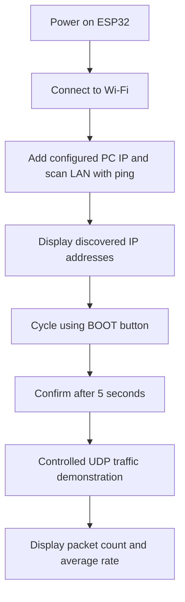

<div align="center">

# 🛡️ Denial of Service Attack — IoT Lab

**ESP32-Based Network Discovery, Target Selection & UDP Traffic Demonstration**

   

**Al-RAZI University · College of Computing · Cybersecurity Department**

</div>

> [!IMPORTANT]
> **Educational and authorized testing only.** This repository documents a traffic-generation demonstration. Sending high-rate traffic to systems without explicit permission may disrupt services. Use an isolated lab network and devices you own or are authorized to test.

## 📖 Overview

This IoT cybersecurity project uses an **ESP32** connected to Wi-Fi, an **I²C 16×2 LCD**, and the built-in **BOOT button** to demonstrate local-network host discovery, on-device IP selection, and UDP packet transmission in a controlled environment. It also displays packet counts and an estimated average send rate.

## ✨ Features

- **Wi-Fi connection:** joins a configured local wireless network.
- **Host discovery:** probes addresses on the local `/24`-style subnet using ICMP ping.
- **Device list:** stores up to **20 IP addresses**; one configured PC IP is added manually before scanning.
- **Button-driven selection:** press **BOOT (GPIO 0)** to cycle through discovered IPs.
- **Automatic confirmation:** confirms the highlighted IP after **5 seconds** without a change.
- **Traffic demonstration:** transmits **1,400-byte UDP payloads** to a configured destination port (**80** in the supplied prototype).
- **Live statistics:** shows target IP suffix, total packets and average packets per second on the LCD; sends additional logs to Serial Monitor.

## 🧰 Hardware

| Component | Purpose |
|---|---|
| ESP32 development board | Wi-Fi networking and main control |
| 16×2 I²C LCD (address `0x27`) | Host selection and live statistics |
| Built-in BOOT button (GPIO `0`) | Cycles through IP addresses |
| USB cable and computer | Power, programming and serial logging |
| Authorized isolated Wi-Fi lab | Controlled test environment |

### LCD connections

| LCD I²C | ESP32 |
|---|---|
| SDA | GPIO 21 |
| SCL | GPIO 22 |
| VCC / GND | Use voltage and wiring appropriate to your LCD module and ESP32 board |

## 🔄 Workflow



## 🖥️ LCD interface

**Scanning**

```text
Scanning LAN...
Scan:135/254
```

**Selecting a device**

```text
Target: 1/5
192.168.0.135
```

**Traffic statistics (illustrative values)**

```text
Tgt:135
P:12000 R:1500
```

The displayed rate is computed as **total packets sent ÷ elapsed whole seconds**, so it is a running average, **not** an instantaneous rate. A measured rate of approximately **1,800 packets/s** was observed in a project demonstration; the code does not enforce that rate, and results vary.

## 📸 Project gallery

Add the three project photographs to the `images/` directory using these filenames:

### 1. Network scanning


### 2. Selecting a device


### 3. UDP traffic statistics


> Until the image files are uploaded, GitHub will show placeholders for the images above.

## 🧩 Software and libraries

- Arduino IDE or another ESP32-compatible Arduino build environment
- ESP32 Arduino core
- `WiFi.h` and `WiFiUdp.h` (ESP32 networking)
- `ESPping.h` (ICMP discovery)
- `Wire.h` (I²C)
- `LiquidCrystal_I2C.h` (LCD driver)

## 🔐 Configuration and safety

The original prototype contains hard-coded Wi-Fi credentials and a fixed computer IP address. **Do not publish real passwords, tokens or private network configuration.** Replace embedded credentials with local configuration excluded from version control; rotate any password that has already been shared.

For demonstrations, use a separate test network with explicit authorization and appropriate rate limits. Keep any high-volume traffic functionality disabled outside the lab. The fixed IP and port in the prototype are environment-specific and may not match another network.

## 🧪 Evaluation notes

The ESP32 reports packet submission attempts and an average software-side send rate. **These counters do not prove that packets arrived, that a service was interrupted, or that a DoS condition occurred.** Validate traffic and system behavior using authorized measurements on the receiving device.

## 👥 Team

**Al-RAZI University — College of Computing — Cybersecurity Department**

- Rakan Al-Hattar
- Raouf Al… *(complete the name before publication)*

## 📄 Disclaimer

This project is presented for academic cybersecurity education and controlled network experiments. It must not be used against networks, devices, or services without permission.
